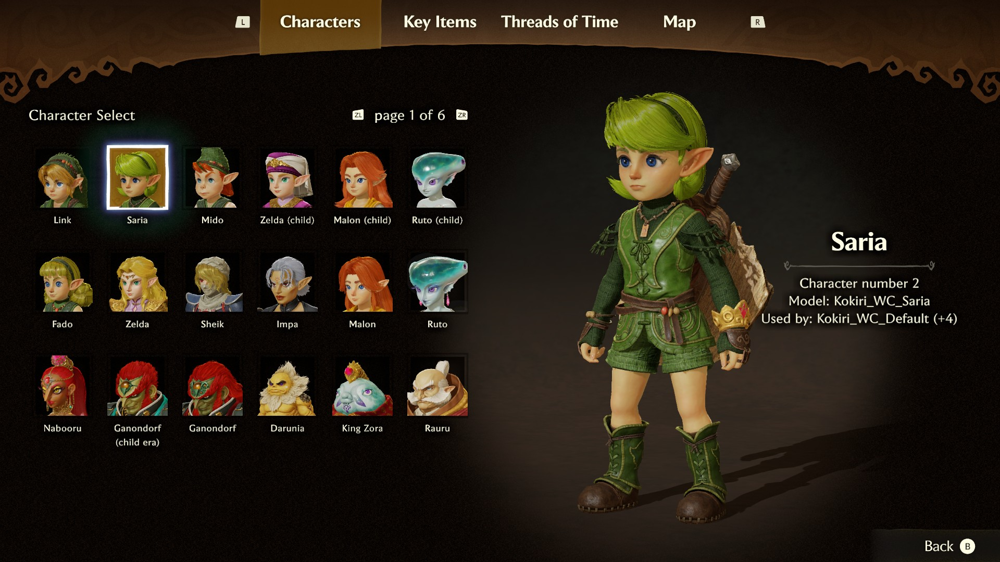
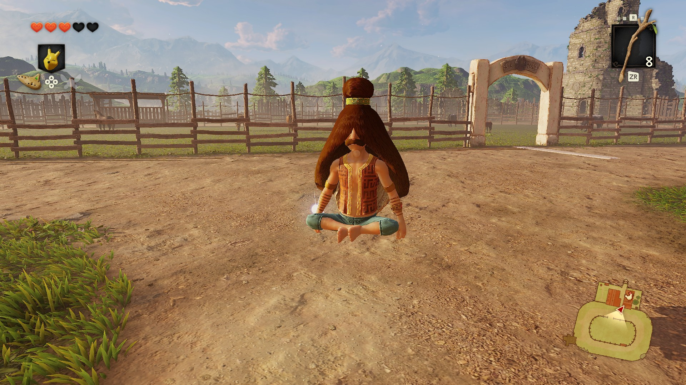
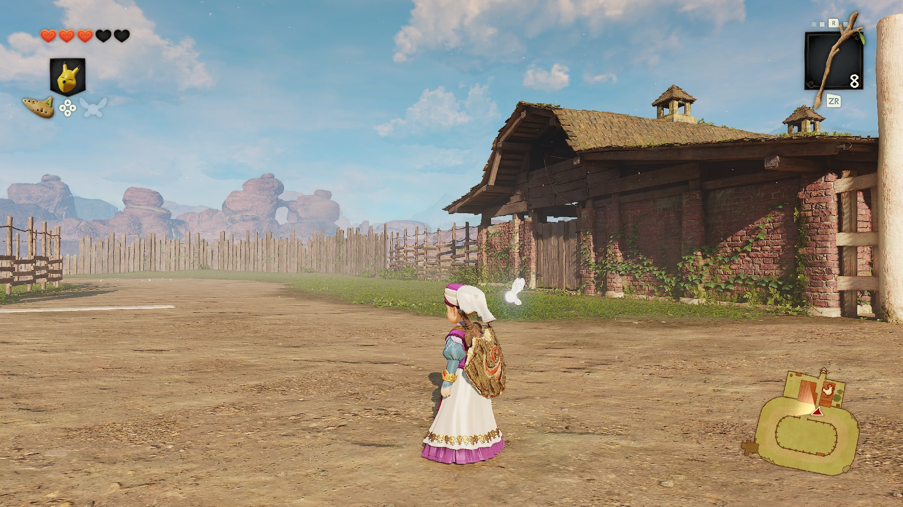
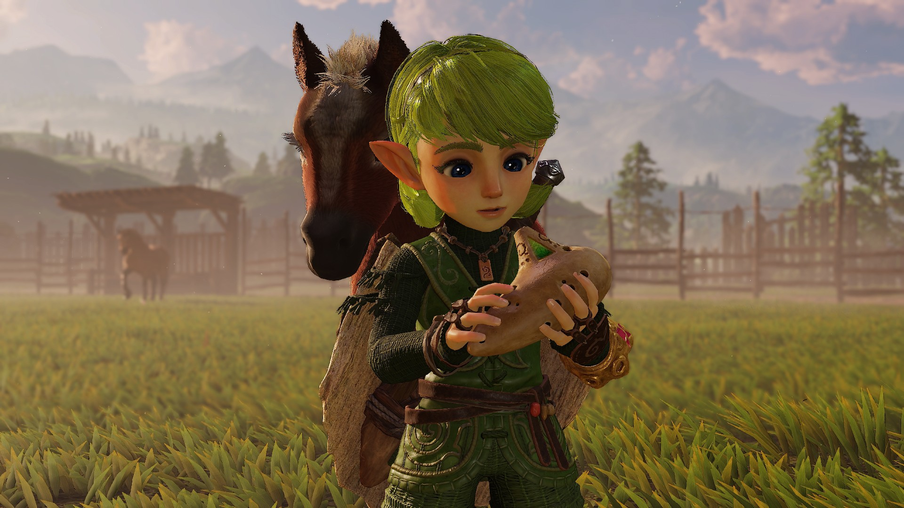
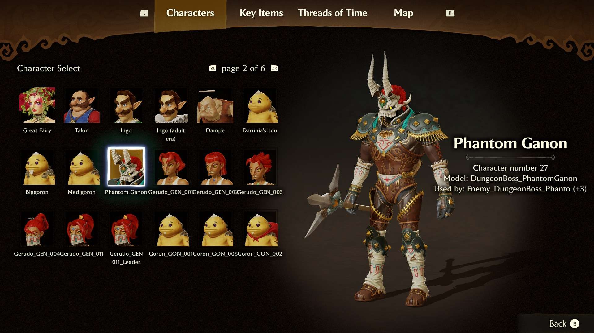
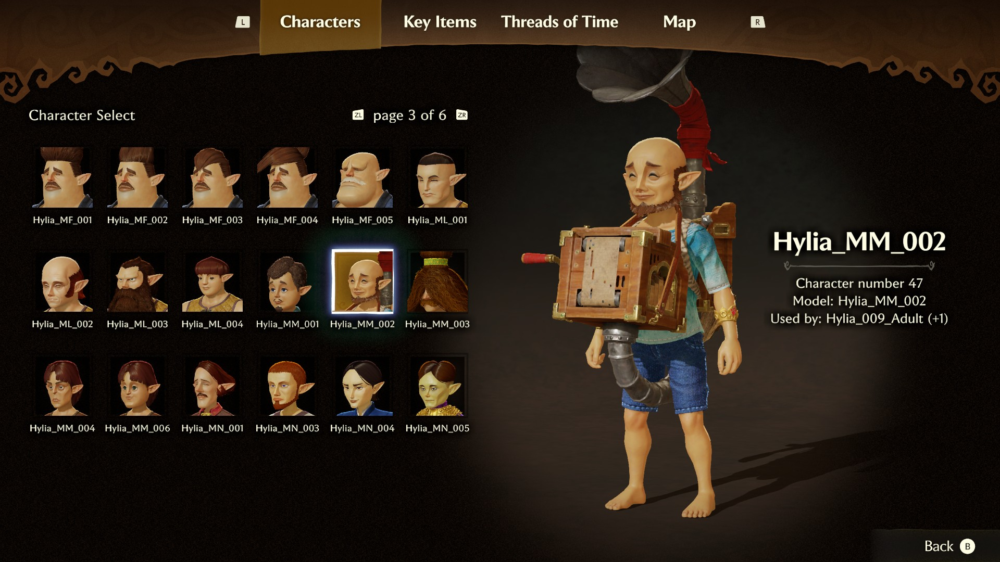
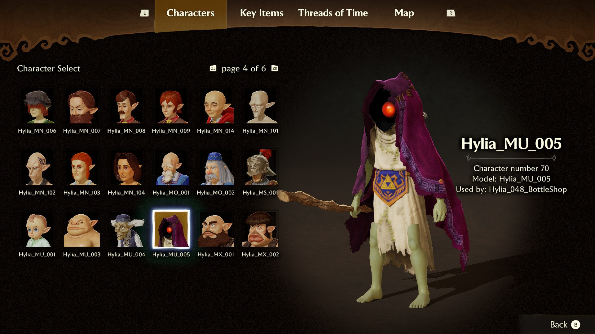
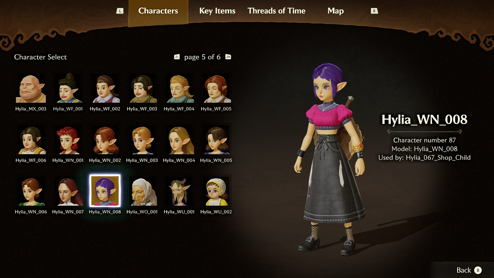
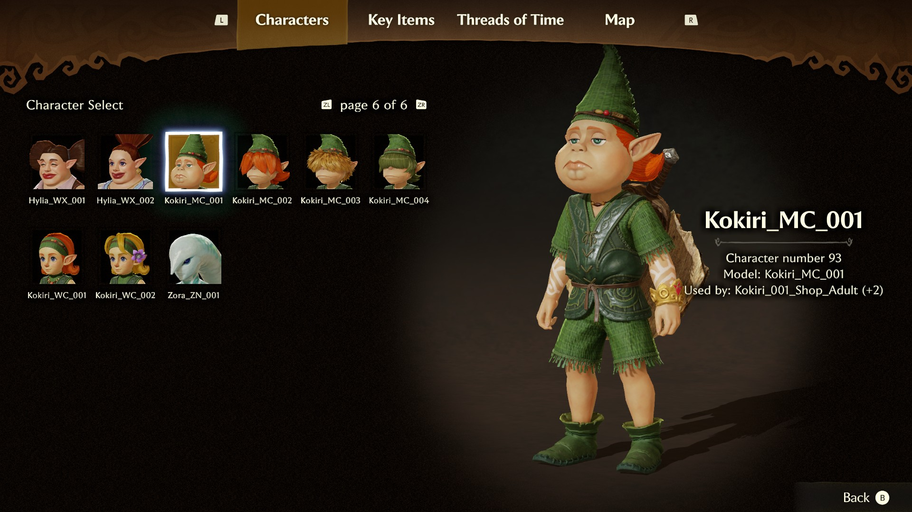

# OoT Character Select

A full character select for *The Legend of Zelda: Ocarina of Time* on Switch 2: a new **Characters** page in the − menu where you pick who you play as, see them live, and swap in the field without a reload.

**[Watch the demo video](https://vimeo.com/1246160686)** (2:45) · **[Download the latest release](https://github.com/snaildev99/OoT-Character-Select/releases/latest)**

[](https://vimeo.com/1246160686)

Not affiliated with or endorsed by Nintendo. No game files are included; you need your own copy of the game. The licence (MIT, see `LICENSE`) applies to the source code in this repository.

**Status:** early test version (v0.1.2). Back up your save before trying it.

## Install

1. Download one of the two zips (pick one):
   - **[v0.1.2-lite](https://github.com/snaildev99/OoT-Character-Select/releases/download/v0.1.2/OoT-Character-Select-v0.1.2-lite.zip)**: 21 characters, 171 MB.
   - **[v0.1.2](https://github.com/snaildev99/OoT-Character-Select/releases/download/v0.1.2/OoT-Character-Select-v0.1.2.zip)**: all 99 characters, 361 MB.
2. In your emulator's game list, right-click the game and choose "Open Mod Data Location".
3. Copy the folder `OoT Character Select` from the zip's `mods` folder into it, and start the game.

It is one mod folder. To remove the mod, delete it. To switch it off without deleting it, use the game's properties, Add-Ons.

What you need:

- **The game's 1.1.1 update**, the current one. Some emulators list the same update as 2.0.0 or v131072; that is fine, it is the same game data. The mod's code patch only applies to this update, so on any other it simply does nothing.
- **A Switch 2 emulator that loads mod folders** (romfs files and IPS patches). Made and tested on Lichii and Fritchii.
- **The PC recompilations (Hookshot, NX2Navi) are not supported yet.** The mod patches the game's original code, which those builds do not run, so it has not been tried there. A port is not ruled out.

Did it run for you, or not? Please [open an issue](https://github.com/snaildev99/OoT-Character-Select/issues) with your emulator, its version and which zip you used. For how a character looks or moves, check the known issues below first.

## What this mod is about

Think of it as a character overhaul for the game's menus: a proper character select, built into the − menu in the game's own style, with a live preview and an instant swap in the field.

It is not here to compete with other playable character mods. The roster of NPCs that ships with it is a proof of concept for the picker; the long-term idea is a home for all of them.

Planned:

- **Support for other mods.** Characters from other people's mods showing up in the picker beside the stock ones, with credit to their authors.
- **Equipment.** Trying out modded equipment from the same menu as you play.
- **More polish on the stock characters:** names, voices and fixes as they are tested.

## Features

- **A fourth menu tab.** Open the − menu, and the header shows four tabs, with **Characters** on the left.
- **A character picker.** Pages of 18 slots with a portrait for each character, in the style of the equipment page. D-pad or left stick to move, ZL / ZR turn pages, A to select. The right stick rotates the character like in the equipment menu.
- **A live preview.** The character you pick slides in beside the grid, and the view zooms to fit characters of any size.
- **In-game swap.** Close the menu and you are that character, in the same spot, facing the same way. There is no reload and no trip to the title screen, only a brief fade-out after closing the menu.
- **Your pick is saved** with the save file.

## How playable the characters are

- **Every character** is a model swap on Link's animations, at the character's own proportions, with basic facial animation and legs that follow slopes and ledges.
- **Saria** is probably the only one that feels naturally playable right now: she moves well and speaks with her own voice.
- **Mido**, and the other Kokiri in the full version, play smoothly if you don't mind Link's voice.
- **Young Zelda** has her own voice and experimental cloth physics on her dress, but her legs still look wrong.
- **Everyone else:** expect visual faults. Only some of the characters have been tested in play.
- **The lite roster:** Link, Saria, Mido, young and adult Zelda, Sheik, Impa, Ganondorf, young and adult Malon, young and adult Ruto, Rauru, King Zora, Nabooru, Darunia, Medigoron, Biggoron and three townspeople.

## Good to know

- **Fixed in v0.1.2: the adult did not load.** In v0.1.1, going through the Door of Time ended on a loading screen that never finished. If you have v0.1.1, replace the folder with the new one.
- **Button prompt mods conflict.** They replace the same texture file, so use either one of those or this mod.
- **Names.** Most of the generic NPCs are still listed under their file names.
- **Riding.** Swapping while riding is not handled yet.
- **Known issue:** browsing the picker for a very long time could freeze the game in earlier builds. This version makes that much less likely, but the cause is not fully found yet, so save before a long browse.

## Screenshots

| | |
| --- | --- |
|  |  |
|  |  |
|  |  |
|  |  |
|  | |

## Is it safe to install?

A mod package from this project holds data files only: changed or added game files (`.zs`, `.ainb`, `.bwav`, `.bphcl`) and one small patch file for the game's own code (`.ips`), which runs inside the emulated game. Nothing in it runs on your computer: no programs, scripts or installers. If a package claiming to be this mod contains anything else, do not use it.

The packages are the files on this repository's [releases page](https://github.com/snaildev99/OoT-Character-Select/releases). The SHA-256 sum of each zip:

| Package | SHA-256 |
| --- | --- |
| `OoT-Character-Select-v0.1.2-lite.zip` | `45bf99f916218098713576e087c5725a19d69090ca01c76de8da41db4a2aac5b` |
| `OoT-Character-Select-v0.1.2.zip` (all 99 characters) | `be1faf4b95e21e88c78407bc50271683fb027bdf6ec5247de4e456ed0a4a9769` |
| `OoT-Character-Select-v0.1.1-lite.zip` | `4188673d5edd9b8afb6cac2ff75e988095e7eb9966a591d76265ba6b00e3833d` |
| `OoT-Character-Select-v0.1.1-repack.zip` (all 99 characters) | `b19392577667d4b5565ad1c2e054069ee4a925f654087140b72bb439114c8c14` |
| `OoT-Character-Select-v0.1.0.zip` (first test version, not on the releases page) | `4b11117ad7ef6849049c48c2c4e41ddca3f776efe6d7ac08968ca23b378b25de` |

Check a zip you got from anywhere else with `certutil -hashfile <zip> SHA256` (Windows) before using it.

Each package comes with `SHA256SUMS.txt` (the sum of every file) and `patch-listings` (the code patch as readable assembly, written by the same build that made the patch). The build is deterministic: the same sources and the same game files give the same bytes, so a package can be rebuilt from this repository and compared. `tools/package.py` makes the package and refuses any file type other than the data files above.

## Credits and AI use

- **Human work.** The idea, the design of the page and the picker, every decision between versions, and all testing in the game are the author's. Each feature was played and approved in game before it went in.
- **Code.** The build scripts, tools and code patches were written with heavy help from Claude (Anthropic), under the author's direction, and checked in game by the author. All of it is in this repository.
- **Voices.** Saria's and young Zelda's voices were made with a locally run voice conversion model, [Seed-VC](https://github.com/Plachtaa/seed-vc) by Plachtaa, with its published pretrained weights (not trained or fine-tuned by the author). The input is Link's own voice clips from the game; the reference voice for each character is that character's own voice clips from the game. No other voice material was used.
- **Visuals.** No generated images. The portraits are captures of the game's own models, taken in game and cut out by a script.
- **This page.** The text was drafted with Claude and edited by the author.

Mod and tools by snaildev99. *The Legend of Zelda: Ocarina of Time* and its characters belong to Nintendo.

## Build from source

You need Windows, Python 3.11, and from your own copy of the game (the 1.1.1 update, build id `E0F3CCFAF50065AE4EA01EB5AEB13B1A45DA3348`): the extracted romfs and the executable image as dumped from memory at base `0x80000000`.

```
python -m venv venv
venv\Scripts\pip install -r requirements.txt
set OOT_ROMFS=C:\path\to\romfs
set OOT_IMAGE=C:\path\to\image.bin
venv\Scripts\python mods\build.py
```

The build writes several working folders to `build\` (the 21 characters of the lite release; `--full` builds all 99). `--install` also copies them into the emulator's mods folder (`%APPDATA%\lichii\load\0400486024DEC000`; set `OOT_MODS_APP=eden` for an emulator that uses `%APPDATA%\eden`). `tools\package.py` merges the working folders into the one folder of a release. The voices folder is built apart by `mods\voices.py`, which needs a voice conversion setup of its own (`docs/NOTES.md`, voices section).

Two inputs are not in this repository, and the full build currently expects both:

- **Portraits.** The pictures in the picker's slots are captured from the running game (`tools/npcshots.py`, `tools/npccutout.py`) into `build-npc\portraits\cut-fit`. Without them, a slot shows a plain silhouette.
- **A third-party model.** An earlier version offered another author's N64 Link model, read from `assets\models`. It is not offered in the picker and not part of the package, but the build still reads it. Making the build run without it is on the list.

## How it works

Everything is built by Python scripts from the untouched game files; nothing is edited by hand. `docs/NOTES.md` is the full working record (every format, address and dead end); this is the short version.

- **Mod folders.** The emulator overlays `romfs` files and applies `exefs` `.ips` patches per folder. The build writes each changed file, plus one combined resource size table, since the game refuses files larger than their table entry.
- **The page.** The game's menus are node graphs (`.ainb`). The Characters page is a graph of our own (`Sequence/CharacterMenu.module.ainb`) with its own screen and layout, hooked into the − menu's graphs. `tools/ainbx.py` reads and writes the graphs.
- **The layout.** The game's layout format (`.buil`) was mapped in full; `tools/layout.py` and `tools/uiedit.py` read, edit and write it. The picker is built from the game's own inventory slot parts.
- **The header.** Four tabs instead of three needs a code patch: the header's builder is given a new preset.
- **Character models.** A saved number says who is picked. A hook on the game's model path formats sends the player's model load to the picked character's file.
- **NPCs as the player.** Each NPC's model file gets a rebuilt skeleton (`tools/npcrig.py`, `tools/bfres.py`): Link's bone names at the NPC's proportions, plus every bone and material the player's code looks up by name.
- **The slide and the zoom.** The menu holds the old and the new character at once; hooks in the menu camera's update move them, scale the view per character and keep the shadow range matched. The hooks are emulated at build time (unicorn) through whole transitions.
- **Portraits.** Each character is captured in game on a black and on a white backdrop; the difference gives the transparency. The pictures are encoded as ASTC and added to a copy of the layout texture archive (`tools/bntxwrite.py`).
- **The field swap.** The field Link is a "resident actor". The swap follows the game's own age change without the area load: the player is deleted, the game's own node creates the new one, and he is woken where the old one stood. The two steps the game has no node for live in the code of a node class no graph uses, so no live game code is changed.
- **Code patches.** `tools/exepatch.py` assembles patches (keystone), places new code in unused space of the executable and writes IPS32. Every patch is checked against the bytes it expects and against the other patches.

## Layout of the repository

- `mods/build.py`: the build (`mods/ui_sandbox.py`, `mods/npc_characters.py` and `mods/field_swap.py` are used by it as libraries and can each build a test variant).
- `tools/`: file format readers and writers, the patcher, the packager, and read-only debug helpers.
- `docs/NOTES.md`: the working notes.
- `docs/images/`: the screenshots on this page.
