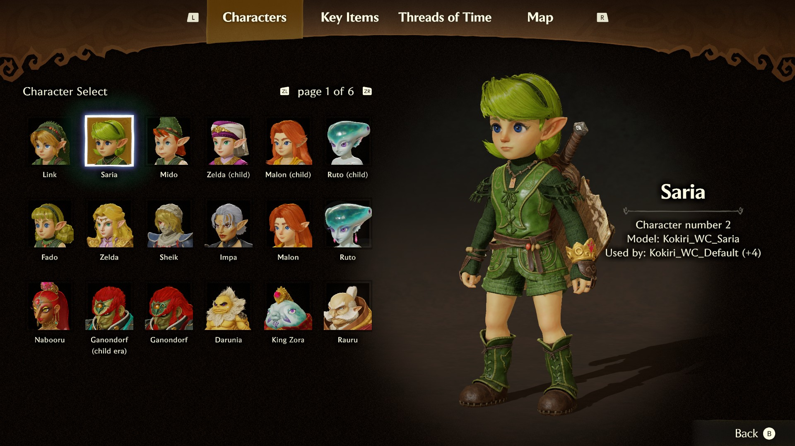
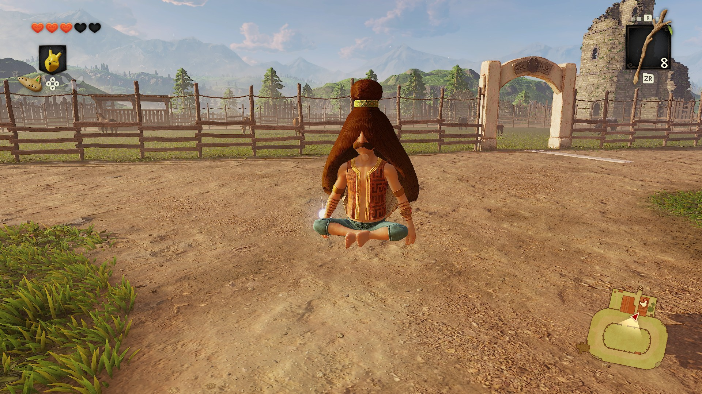
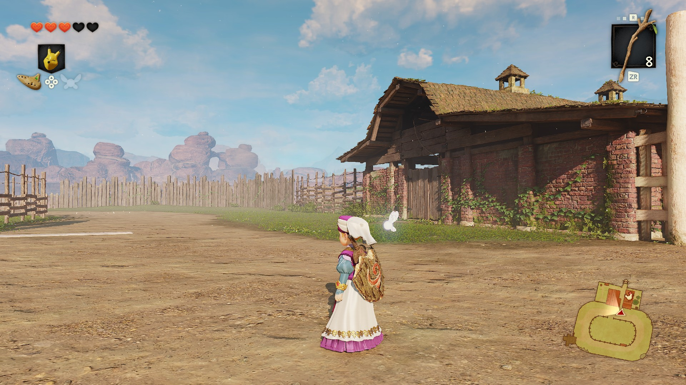
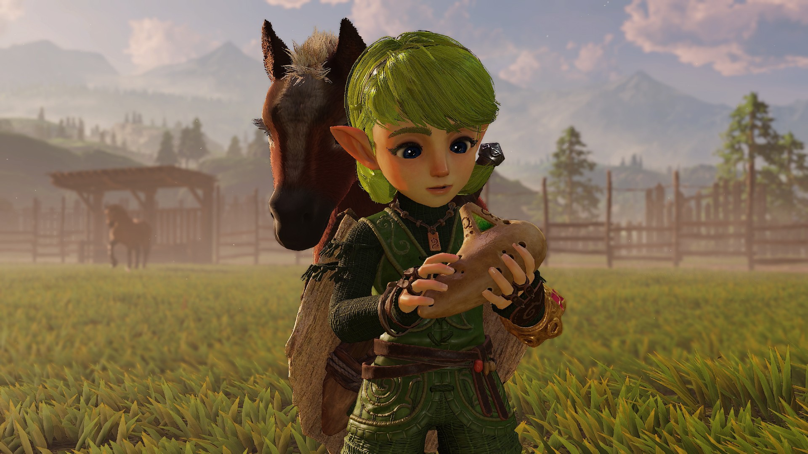
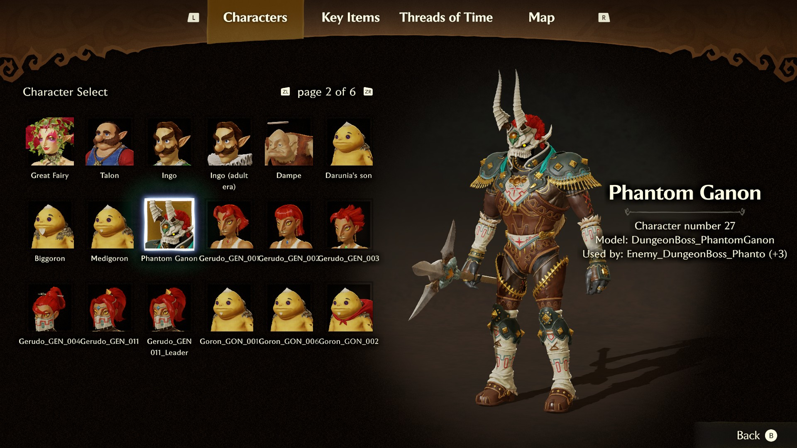
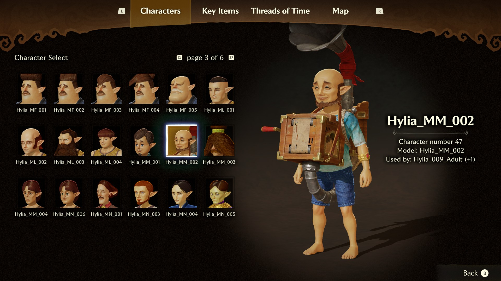
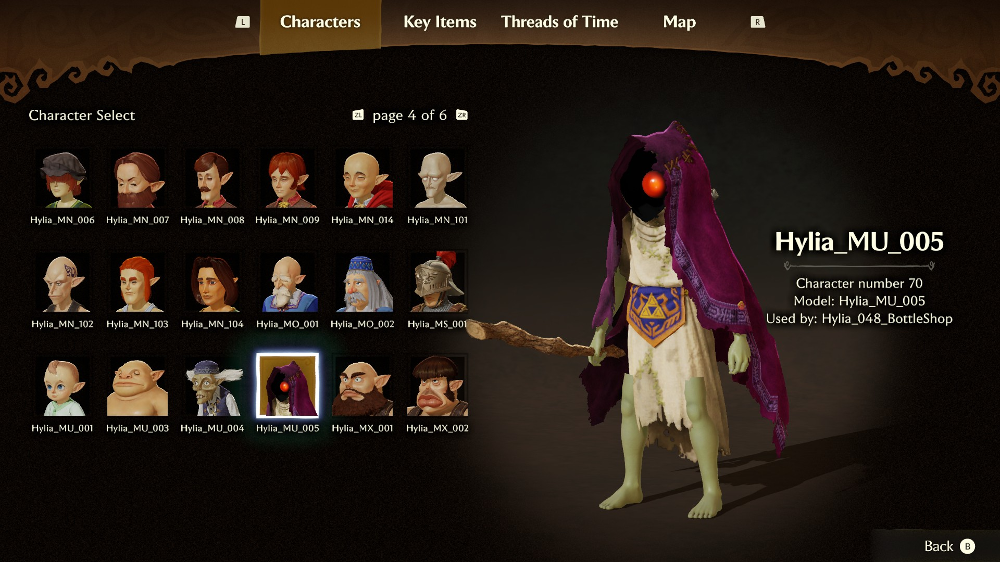
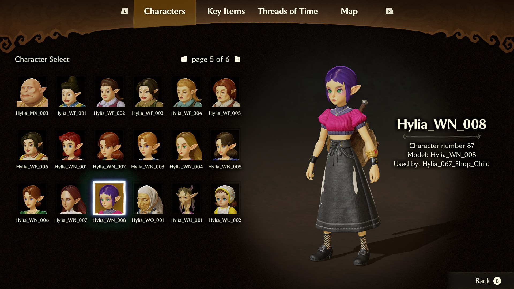
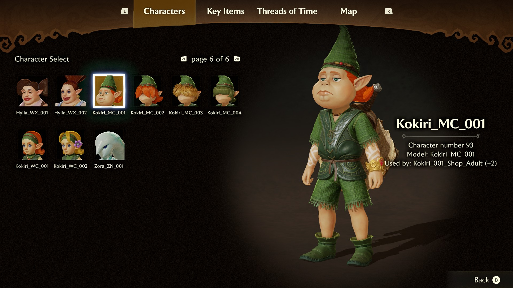

# OoT Character Select

A full character select for *The Legend of Zelda: Ocarina of Time* on Switch 2: a new **Characters** page in the − menu where you pick who you play as, see them live, and swap in the field without a reload.

**[Watch the demo video](https://vimeo.com/1246160686)** (2:45) · **[Download the mod](https://github.com/snaildev99/OoT-Character-Select/releases/latest)**

[](https://vimeo.com/1246160686)

Not affiliated with or endorsed by Nintendo. This is a mod, not the game: you need your own copy of the game, and the mod does nothing without it. The licence (MIT, see `LICENSE`) applies to the source code in this repository.

**Status:** early test version (v0.2.2). Back up your save before trying it.

## Install

1. Download the mod: **[v0.2.2](https://github.com/snaildev99/OoT-Character-Select/releases/download/v0.2.2/OoT-Character-Select-v0.2.2.zip)**, 115 characters, 145 MB. Unzip it.
2. Dump the game's RomFS: in your emulator's game list, right-click the game, choose "Dump RomFS" and, if it asks, "Full". (Ryujinx: right-click, Extract Data, RomFS, and note the folder you pick.)
3. Open the zip's `build-from-your-game` folder and run `build-from-your-game.exe`. It finds the dump (or asks you to drag the RomFS folder onto its window), makes the characters' models, colours and the menu from your copy of the game into the zip's `OoT Character Select` folder, and says "Done". It takes a minute or two, once.
4. In your emulator's game list, right-click the game and choose "Open Mod Data Location". Copy the folder `OoT Character Select` from the zip's `mods` folder into it, and start the game.

On Linux, Steam Deck or macOS, step 3 is `python3 build-from-your-game/player.py --romfs <the dumped RomFS folder>` (after `python3 -m pip install numpy pyzstd astc-encoder-py texture2ddecoder`). In [Squadala](https://github.com/daurosk/oot-remake-multiplayer), the co-op kit offers the mod at its first start and does all of this itself.

It is one mod folder. If you have an older version, delete its folder first, then copy the new one. To remove the mod, delete it. To switch it off without deleting it, use the game's properties, Add-Ons. The RomFS dump is only needed for step 3; you can delete it afterwards.

What you need:

- **The game's 1.1.1 update**, the current one. Some emulators list the same update as 2.0.0 or v131072; that is fine, it is the same game data. The mod's code patch only applies to this update, so on any other it simply does nothing.
- **A Switch 2 emulator that loads mod folders** (romfs files and IPS patches). Made and tested on Lichii and Fritchii.
- **Longshot and Hookshot (the native PC builds): not for ordinary installs yet.** They compile the game's code ahead of time and leave a mod's code patch out, so on a normal Longshot or Hookshot the Characters page can show up but picking a character does nothing, even after building the game again. It does run on a Longshot built with code mod support, which is still a pull request there ([Longshot 134](https://git.magicbean.dev/MagicBeanDev/Longshot/pulls/134)): played that way on Windows, with v0.1.3, v0.2.0 and v0.2.1 (the page, picks, voices, cloth, Customize with the clothing colours and a new character all worked there). Once that support is in a Longshot release, the mod folder goes into Longshot's `mods` folder and the game is built again. NX2Navi has not been tried.

Did it run for you, or not? Please [open an issue](https://github.com/snaildev99/OoT-Character-Select/issues) with your emulator, its version and which zip you used. For how a character looks or moves, check the known issues below first.

## What this mod is about

Think of it as a character overhaul for the game's menus: a proper character select, built into the − menu in the game's own style, with a live preview and an instant swap in the field.

It is not here to compete with other playable character mods. The roster of NPCs that ships with it is a proof of concept for the picker; the long-term idea is a home for all of them.

Planned:

- **Support for other mods.** Characters from other people's mods showing up in the picker beside the stock ones, with credit to their authors.
- **Equipment.** Trying out modded equipment from the same menu as you play.
- **More customization:** outfits and accessories in the Customize mode, and finer clothing colours.
- **More polish on the stock characters:** names, voices and fixes as they are tested.

## Features

- **A fourth menu tab.** Open the − menu, and the header shows four tabs, with **Characters** on the left.
- **A character picker.** Pages of 18 slots with a portrait for each character, in the style of the equipment page. D-pad or left stick to move, ZL / ZR turn pages, A to select. The right stick rotates the character like in the equipment menu.
- **A live preview.** The character you pick slides in beside the grid, and the view zooms to fit characters of any size.
- **In-game swap.** Close the menu and you are that character, in the same spot, facing the same way. There is no reload and no trip to the title screen, only a brief fade-out after closing the menu.
- **Customize.** X on the Characters page opens Customize for the character shown: hair colour (nine colours), eye colour (seven), up to three clothing colours (seven each) and equipment shown or hidden. The choices are kept per character and show in the field as well.
- **Cloth.** Hair, sleeves, skirts and dresses move as cloth on the characters that have them, and dresses follow the legs.
- **Voices.** Some characters speak with their own voice instead of Link's, as a child and as an adult.
- **Your pick is saved** with the save file.

## How playable the characters are

- **Every character** is a model swap on Link's animations, at the character's own proportions, with basic facial animation and legs that follow slopes and ledges.
- **With their own voice:** Saria, young Zelda, Mido, young Ruto, young and adult Malon, Fado, the Great Fairy and Darunia's son. The other Kokiri boys speak with Mido's voice and the other Kokiri girls with Fado's. Everybody else has Link's.
- **Dresses and skirts** are cloth on 48 characters, with the dress hung on the legs so that running and the sword stance no longer push the legs through. Hair and smaller pieces are cloth on 110 of the 115.
- **New in v0.2.0, beyond the NPCs:** Dark Link, Skull Kid, Koume and Kotake (two forms), Twinrova, three Iron Knuckles, a Gibdo, a ReDead, two Moblins, a Wolfos, a Lizalfos, a cow, and Link as he looks in the opening. They are enemies' and other actors' models on Link's animations: playable, and odd in places.
- **Everyone else:** expect visual faults. Only some of the 115 have been tested in play.

## Good to know

- **New in v0.2.2:** the same characters and features as v0.2.1, in a much smaller download (145 MB instead of 1,023 MB). The characters' models, their colours and the menu are made on your PC from your own copy of the game by the tool in the zip (install step 3). It takes a minute or two, once.
- **New in v0.2.1:** clothing colours in Customize. The rows Clothing Color, Clothing Color 2 and Clothing Color 3 each recolour one part of the character's clothes in one of seven colours; on Link they are the tunic and hat, the vest, and the leather with the boots. Every colour is a recoloured copy of the character's own clothing textures, which is why the download grew from 712 MB to 1,023 MB.
- **New in v0.2.0:** 16 more characters (115 in all, on seven pages), the Customize mode, cloth for nearly every character with the dresses following the legs, and voices for nine characters at both ages. The download is one zip now; there is no lite version of it.
- **Customize is unfinished.** Hair colour, eye colour, the clothing colours and the equipment switch work. The clothing colours are a first cut that covers the main colours: a script picks up to three parts of each character's clothes by their colour, so what a row changes differs from character to character, about half of the characters have only one part that changes, and a second colour inside one garment (a trim, a pattern) keeps its own. The adult's Goron and Zora tunics are models of their own and are not covered. Outfits and accessories are not in yet. The choices are kept while the game runs but are not written to the save file yet, so they are gone after a restart. Hair and clothing colours are recoloured copies of each character's own textures; a few characters have no hair texture to recolour. While the mod is on, three of the amiibo marker's sounds are used as the mode's menu sounds.
- **Fixed in v0.1.3: a crash on Longshot and Hookshot builds with code mods.** One of the mod's code routines was written in a way the console and the emulators accept and those builds do not; picking a character crashed there. On an emulator nothing changes from v0.1.2.
- **Fixed in v0.1.2: the adult did not load.** In v0.1.1, going through the Door of Time ended on a loading screen that never finished. If you have v0.1.1, replace the folder with the new one.
- **Known issue on Longshot and Hookshot builds with code mods: switching the mod Off leaves half of it.** The mod's code patch is built into the game, so it stays until the game is built again, while the mod's other files stop loading. The game runs, but the − menu's tabs are drawn wrong. For a clean off, build the game again with the mod switched off or removed; switching it back On needs no build. On an emulator, Off is clean.
- **Button prompt mods conflict.** They replace the same texture file, so use either one of those or this mod.
- **Names.** Most of the generic NPCs are still listed under their file names.
- **Riding.** Swapping while riding is not handled yet.
- **Known issue:** browsing the picker for a very long time could freeze the game in earlier builds. This version makes that much less likely, but the cause is not fully found yet, so save before a long browse.

## Screenshots

| | |
| --- | --- |
|  |  |
|  |  |
|  |  |
|  |  |
|  | |

## Is it safe to install?

The zip holds the mod and one tool:

- **`mods/OoT Character Select`**, the mod folder: one code patch (`.ips`) that runs inside the emulated game, the Characters page's menu graph, and the voices for some characters.
- **`build-from-your-game`**, the tool that makes the rest of the mod from your own copy of the game: the characters set up as playable models with their cloth files, the recoloured hair and clothing textures for Customize, and the menu with the picker's portraits. `recipes.json` and `patches.bin` are the mod's changes to those files (byte patches and colour settings, useless without the game). `player.py`, `delta.py`, `colours.py` and `lib` are the tool's Python source, readable, and the same as in this repository's `gamefiles` and `tools` folders. `build-from-your-game.exe` is that same Python packed into one program with PyInstaller, for Windows players without Python.

The tool reads only the RomFS folder it is given and writes only into the mod folder; it does not go online. It checks every game file it reads and every file it makes against the ones the release was tested with, so a dump of another game version is refused instead of half made. If something claiming to be this mod contains anything else, do not use it.

The mod is downloaded from this repository's [downloads page](https://github.com/snaildev99/OoT-Character-Select/releases). The SHA-256 sum of each zip:

| Package | SHA-256 |
| --- | --- |
| `OoT-Character-Select-v0.2.2.zip` (115 characters) | `75cd9a4c71645d1abcf7151fc074df1922af3f9db0b31a3c383eaf7d2497620b` |
| `OoT-Character-Select-v0.2.1.zip` (115 characters) | `e2944017998b100371a3a697724c36018cae24db3835c40aca19cf2c946b2585` |
| `OoT-Character-Select-v0.2.0.zip` (115 characters) | `a7d2f04a4ed17dde3c738b55f70564016f91e9da94efc10d8ccd113e53f5135b` |
| `OoT-Character-Select-v0.1.3-lite.zip` | `ff60cd9bd4f7c5ca1cdbfbb2242fd8fd2dfa08e221e856dd1c2c65d64dd2d5e1` |
| `OoT-Character-Select-v0.1.3.zip` (all 99 characters) | `9f3fb3d6ffcf4a6bfc9d7b5655ba55a22fe58cae96eaa08986e6fee255079a4b` |
| `OoT-Character-Select-v0.1.2-lite.zip` | `45bf99f916218098713576e087c5725a19d69090ca01c76de8da41db4a2aac5b` |
| `OoT-Character-Select-v0.1.2.zip` (all 99 characters) | `be1faf4b95e21e88c78407bc50271683fb027bdf6ec5247de4e456ed0a4a9769` |
| `OoT-Character-Select-v0.1.1-lite.zip` | `4188673d5edd9b8afb6cac2ff75e988095e7eb9966a591d76265ba6b00e3833d` |
| `OoT-Character-Select-v0.1.1-repack.zip` (all 99 characters) | `b19392577667d4b5565ad1c2e054069ee4a925f654087140b72bb439114c8c14` |
| `OoT-Character-Select-v0.1.0.zip` (first test version, not on the releases page) | `4b11117ad7ef6849049c48c2c4e41ddca3f776efe6d7ac08968ca23b378b25de` |

Check a zip you got from anywhere else with `certutil -hashfile <zip> SHA256` (Windows) before using it.

Each package comes with `SHA256SUMS.txt` (the sum of every file) and `patch-listings` (the code patch as readable assembly, written by the same build that made the patch). The build is deterministic: the same sources and the same game files give the same bytes, so a package can be rebuilt from this repository and compared. `tools/package.py` makes the package and refuses anything that is not mod data. Since v0.2.2, `gamefiles/release.py` turns that package into the zip: it writes the recipes, builds the tool, has the tool make every file again from the game, and compares each one with the package before it writes the zip (the same bytes; the clothing colours that are re-encoded as ASTC within one step of 255).

## Credits and AI use

- **Human work.** The idea, the design of the page and the picker, every decision between versions, and all testing in the game are the author's. Each feature was played and approved in game before it went in.
- **Code.** The build scripts, tools and code patches were written with heavy help from Claude (Anthropic), under the author's direction, and checked in game by the author. All of it is in this repository.
- **Voices.** The characters' voices (Saria, young Zelda, Mido, young Ruto, young and adult Malon, Fado, the Great Fairy, Darunia's son) were made with a locally run voice conversion model, [Seed-VC](https://github.com/Plachtaa/seed-vc) by Plachtaa, with its published pretrained weights (not trained or fine-tuned by the author). The input is Link's own voice clips from the game; the reference voice for each character is that character's own voice clips from the game. No other voice material was used.
- **Visuals.** No generated images. The portraits are captures of the game's own models, taken in game and cut out by a script. The hair and clothing colours are the game's own textures with their colours shifted by a script (`tools/texrecolor.py`; since v0.2.2 on your PC, by the tool in the zip).
- **This page.** The text was drafted with Claude and edited by the author.

Mod and tools by snaildev99. *The Legend of Zelda: Ocarina of Time* and its characters belong to Nintendo.

## Build from source

You need Windows, Python 3.11, and from your own copy of the game (the 1.1.1 update, build id `E0F3CCFAF50065AE4EA01EB5AEB13B1A45DA3348`): the extracted romfs and the executable image as dumped from memory at base `0x80000000`.

```
python -m venv venv
venv\Scripts\pip install -r requirements.txt
set OOT_ROMFS=C:\path\to\romfs
set OOT_IMAGE=C:\path\to\image.bin
venv\Scripts\python mods\build.py
```

The build writes several working folders to `build\` (a short roster of 37 characters by default; `--full` builds all 115, which is what the release is). `--install` also copies them into the emulator's mods folder (`%APPDATA%\lichii\load\0400486024DEC000`; set `OOT_MODS_APP=eden` for an emulator that uses `%APPDATA%\eden`). `tools\package.py` merges the working folders into the one mod folder. The voices folder is built apart by `mods\voices.py`, which needs a voice conversion setup of its own (`docs/NOTES.md`, voices section), and the Customize mode's folder by `mods\customize.py`, which reads the folders already installed.

Two inputs are not in this repository, and the full build currently expects both:

- **Portraits.** The pictures in the picker's slots are captured from the running game (`tools/npcshots.py`, `tools/npccutout.py`) into `build-npc\portraits\cut-fit`. Without them, a slot shows a plain silhouette.
- **A third-party model.** An earlier version offered another author's N64 Link model, read from `assets\models`. It is not offered in the picker and not part of the package, but the build still reads it. Making the build run without it is on the list.

## How it works

Everything is built by Python scripts from the untouched game files; nothing is edited by hand. `docs/NOTES.md` is the full working record (every format, address and dead end); this is the short version.

- **Mod folders.** The emulator overlays `romfs` files and applies `exefs` `.ips` patches per folder. The build writes each changed file, plus one combined resource size table, since the game refuses files larger than their table entry.
- **The page.** The game's menus are node graphs (`.ainb`). The Characters page is a graph of our own (`Sequence/CharacterMenu.module.ainb`) with its own screen and layout, hooked into the − menu's graphs. `tools/ainbx.py` reads and writes the graphs.
- **The layout.** The game's layout format (`.buil`) was mapped in full; `tools/layout.py` and `tools/uiedit.py` read, edit and write it. The picker is built from the game's own inventory slot parts.
- **The header.** Four tabs instead of three needs a code patch: the header's builder is given a new preset.
- **Character models.** A saved number says who is picked. A hook on the game's model path formats sends the player's model load to the picked character's file.
- **NPCs as the player.** Each NPC's model file gets a rebuilt skeleton (`tools/npcrig.py`, `tools/bfres.py`): Link's bone names at the NPC's proportions, plus every bone and material the player's code looks up by name.
- **The slide and the zoom.** The menu holds the old and the new character at once; hooks in the menu camera's update move them, scale the view per character and keep the shadow range matched. The hooks are emulated at build time (unicorn) through whole transitions.
- **Portraits.** Each character is captured in game on a black and on a white backdrop; the difference gives the transparency. The pictures are encoded as ASTC and added to a copy of the layout texture archive (`tools/bntxwrite.py`).
- **The field swap.** The field Link is a "resident actor". The swap follows the game's own age change without the area load: the player is deleted, the game's own node creates the new one, and he is woken where the old one stood. The two steps the game has no node for live in the code of a node class no graph uses, so no live game code is changed.
- **Code patches.** `tools/exepatch.py` assembles patches (keystone), places new code in unused space of the executable and writes IPS32. Every patch is checked against the bytes it expects and against the other patches.

## Layout of the repository

- `mods/build.py`: the build (`mods/ui_sandbox.py`, `mods/npc_characters.py`, `mods/more_characters.py` and `mods/field_swap.py` are used by it as libraries and can each build a test variant). `mods/customize.py` builds the Customize mode over the installed folders, `mods/voices.py` the voices.
- `tools/`: file format readers and writers, the patcher, the packager, and read-only debug helpers.
- `docs/NOTES.md`: the working notes.
- `docs/images/`: the screenshots on this page.
